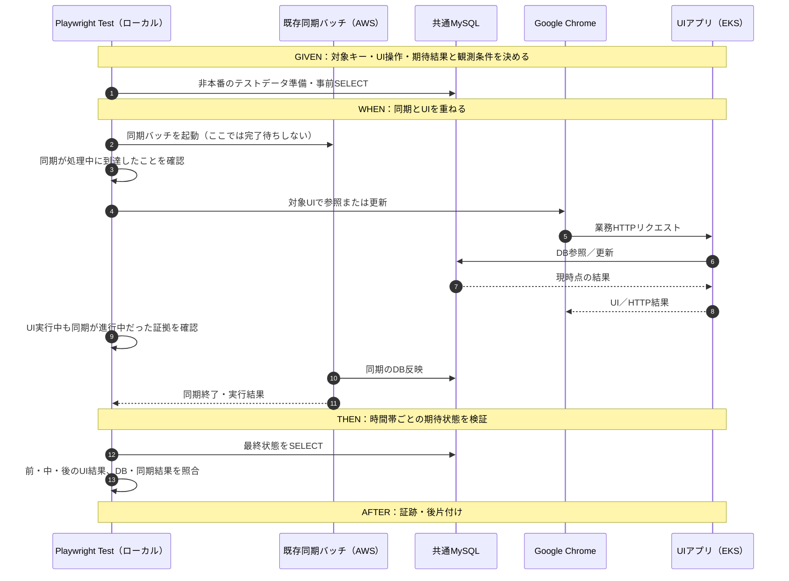

# 機能横断シナリオ試験・システム整合性検証方針

- 状態：**試験方針・候補シナリオの設計案**（実システムのコード・DDL・IF・業務期待動作に照らした確定および実行は未実施）
- 位置付け：個別機能の結合試験とは**別**の「機能横断・システムリスク検証」。業務E2Eに似た複数機能の実行経路を使うが、**網羅的な業務フロー検証を目的としない**。
- 前提資料：[個別機能の結合試験・大量データ照合方針](integration-test-strategy.md)
- 対象イメージ：複数の同期バッチ／データ集合、UIの参照・更新、共通MySQL、AWS上のアプリ。**実際に存在する機能とデータ関係だけで具体化**する。
- 原則：業務アプリ本体を試験専用に改修しない。既存の同期コマンドとローカルPlaywright Test／Google Chromeを用い、試験のための過剰な基盤構築はしない。

## 1. 試験目的と個別結合試験との違い

**問い：各機能が単独では正しく動いていても、機能同士が時間差・並行・部分失敗・不整合データを介して連携すると、意図しない結果にならないか。**

| 試験 | 主な問い | 観測の中心 |
| --- | --- | --- |
| 個別UI結合試験 | このUI操作と外部IF／DBが期待どおり連携するか | UI・HTTP・DB結果 |
| 個別同期バッチ結合試験 | 上流応答どおりにDBの有効データが揃うか／エラーを扱えるか | 終了結果・有効データ全件・論理／物理削除 |
| **本資料の機能横断シナリオ試験** | **バッチとUI、または複数の同期処理の組合せ・実行順序・競合でシステムが破綻しないか** | 時系列、複数機能の結果、共有データの整合性、復旧 |

既存試験を長いE2Eに置き換えない。既存の個別試験を前提として、**その間にある見落としやすいリスクだけ**を少数のシナリオで拾う。

## 2. まず維持したいシステム上の不変条件

1. **同期完了後の整合性：** 正常完了した同期対象について、DBの**有効データ集合**は上流レスポンスに一致する。テーブルごとの論理／物理削除仕様を含む。
2. **関連整合性：** UIや他の処理が使う親子関係・参照関係が破綻していない。孤立行、間違った参照先、業務上同時に成立してはいけない状態を見逃さない。
3. **可視性：** 同期途中にUIがアクセスした際、実装・仕様で許容された状態（旧データ、新データ、待機・利用不可など）の範囲に収まる。**一時的な旧データ表示が必ず不具合という意味ではない。**
4. **失敗時の一貫性：** 一部同期や一部処理が失敗しても、意図しない「成功扱い」、気付かない部分更新、UIの誤った正常表示を起こさない。**全体ロールバックか部分確定かは実装・業務仕様で決め、試験側で勝手に仮定しない。**
5. **競合と回復：** UI操作と同期処理が競合しても、重要なユーザー変更の消失、重複登録、意図しない再有効化が起こらない、または仕様で定めた競合解決に従う。失敗後の再実行で整合状態へ戻る。
6. **試験の観測性：** シナリオで意図した実行順序／重なりを**証跡で確認できた場合のみ**合否を確定する。タイミングを作れなかった実行をPASSにしない。

上記は試験の評価軸。**どの旧／新データ表示を許容するか、失敗時のトランザクション境界、UIの更新優先順位などは現時点で未確定**であり、実装と業務期待から具体的な期待値にする。

## 3. 機能横断シナリオ候補（リスク起点）

P0は優先候補、P1は必要な機能・実装が確認できた場合に追加する。ケース数を機械的に増やすのではなく、**異なる障害モードをカバーする最小セット**を選ぶ。

| ID | 優先 | システムとして起き得る問題 | 実行順序・データの与え方 | Thenで確認すること |
| --- | --- | --- | --- | --- |
| SYS-01 | P0 | 同期は成功したのにUIが旧情報／削除済み情報を表示 | Given：同期前のDBとUI参照条件 → When：同期成功 → UI参照 | 同期後のUI／HTTP／DBが整合。キャッシュがあるなら許容期限と更新条件を確認 |
| SYS-02 | P0 | **複数の同期処理のうち一部だけ失敗**し、成功側と失敗側のデータが矛盾 | Given：関連する同期対象A/B → When：A成功・B失敗 → UI参照／業務操作 | 失敗の識別、関連整合性、UIのエラー／利用制限／表示、期待する確定範囲 |
| SYS-03 | P0 | **同期データ間の不整合**で参照切れ・誤った紐付けが発生 | Given：親子キーの不一致や片側欠落などを再現 → When：関連する同期を実行 → UI操作 | 不整合の検出・許容／除外／失敗判定の仕様、孤立レコードや誤表示がないこと |
| SYS-04 | P0 | **同期中のUI参照**で、旧／新データが危険な形で混在 | Given：同期前状態 → When：同期実行を開始して処理中にUI参照 → 完了後再参照 | 処理中と完了後のUI・HTTP・DB。部分更新を許容するか、画面利用制限が必要かを仕様に照合 |
| SYS-05 | P0 | **同期中のUI更新**で更新競合、上書き消失、DBエラー | Given：同一業務キーの対象 → When：同期処理とUI更新を重ねる | どちらが優先か／競合検知／拒否や再試行／最終DB整合性が仕様どおり |
| SYS-06 | P1 | **単一の同期バッチ内部の途中失敗**で、半端なデータが残る | Given：複数テーブルにまたがる対象 → When：途中で失敗させる → UI参照 | ロールバック範囲または部分確定範囲、関連整合性、UIの失敗時動作 |
| SYS-07 | P1 | 部分失敗後の再同期で二重登録・削除漏れ・復旧不能 | Given：SYS-02／06相当の失敗後状態 → When：再同期 → UI参照 | 有効データの整合回復、重複ゼロ、論理／物理削除、成功結果の表示 |
| SYS-08 | P1 | UI操作の後に同期が走り、UIの更新が消える／意図せず戻る | Given：同期対象の業務データ → When：UIで変更 → 同期実行 | データ所有者・更新優先順位・最終DB・画面が期待どおり |
| SYS-09 | P1 | 正常な再同期で二重作成・再有効化・画面表示が変わる | Given：同期済み状態 → When：同じ対象を再同期 → UI参照 | 冪等性、有効キー集合・更新日時等の許容差、画面結果 |
| SYS-10 | P1 | 一方のリージョンから見たUIだけ更新後の状態が違う | Given：共有DBへ同期 → When：両アプリからUI参照 | 必要に応じたキャッシュ／読み込み反映の整合性。**ルーティング確率は試験しない** |

**整理のポイント：**
- SYS-02は**複数の同期の一部が失敗**、SYS-06は**1つの同期の途中で失敗**。起こり得る構造と回復策が違うため分ける。
- SYS-03は**入力時点でデータ同士が整合していない**場合。SYS-04／05は**実行中に時間的に状態が重なる**場合。混同しない。
- SYS-05／08の最終状態は「必ずバッチが勝つ」「必ずUIが勝つ」と先に決めない。共有するデータの管理主体を実装・業務仕様から確認する。
- SYS-02／03／06の「異常」は**意図した失敗や業務上許容された制御になればシナリオ試験としてPASS**とする。アプリが異常状態を正常と誤認したらFAIL。

## 4. 典型的な実行シーケンス

### 4.1 同期完了後のUI操作（SYS-01、SYS-02、SYS-03、SYS-07）

- 異常系では**同期の失敗も期待結果として許容可能**。同期を実行したという事実だけでは合格しない。UI操作の前にどのDB状態が確定したかを確認する。
- 複数同期の一部失敗では、同期A／Bの**各終了結果**と同じ業務キーに対するデータの所属・参照関係を記録する。

### 4.2 同期処理中のUI操作（SYS-04、SYS-05）

**同期バッチは「コマンド自体は同期」でも、Playwright Testから子プロセス等で起動すれば、終了を`await`する前に別のUI操作を進められる。** 最後に同期の終了を待つ。現行バッチの実際の起動方法・エラー結果はコード確認後に確定する。

- **タイミングの再現性を最優先：** 同期が終わってからUI操作しただけの実行はSYS-04／05の成功とみなさず、**未成立・再試験**とする。実行順序・時刻・対象キー・バッチ稼働中だった根拠を記録する。
- 完了待ちのない任意の`sleep`による偶然の衝突は避ける。既存の状態確認（同期プロセス／DB観測）、処理に時間がかかる現実のデータ量、必要であれば**アプリを改修せず外部モック側で制御できる待機・遅延**などを検討する。ただし、**現在のモックはHTTPステータスのみ**を返し、待機・遅延機能は未実装である。
- DBの処理途中状態を観測できなくても、許容できるUI結果が明確で、同期とUIの重なりが確認できれば実施可能。観測できない／確定しない場合は無理にPASSへしない。

## 5. Given / When / Then / After の試験ケース共通形式

| フェーズ | 決めること |
| --- | --- |
| **Given** | 対象の業務キー、同期A／B、上流の入力条件・モック条件、DBのINSERT／UPDATE／DELETE、前提となるUI状態、変更前後のSELECT、試験対象データの退避 |
| **When** | 同期A→B→UI、同期A成功＋B失敗→UI、同期実行中↔UI参照／更新など、**実行順序と重なり方** |
| **Then** | バッチ終了結果、UIのHTTP／表示、操作後のDBと事前状態との差分、論理／物理削除、キー・値・関連、失敗検知・回復、タイミングの成立 |
| **After** | モック設定を試験前の状態に戻す。必要なテストデータを復元する。各処理の終了を回収し、証跡・未確認範囲を保存する |

**最小のケース記録：** ケースID／対象キー／関与機能／想定障害／Givenの事前条件／Whenの順序／Thenの明示的な期待値／After／根拠（UI・HTTP・DB・バッチ結果・時刻）／判定（PASS・FAIL・判定保留）。

## 6. 実装時に先に確認すること

下記は原則として**実装・DB定義・IF仕様から読み取り、試験ケースに落とす作業**。調査自体を大きな先行プロジェクトにしない。ただし、コードだけで決まらない業務上の許容状態は人間が判断する。

1. **連携する機能とデータの接点：** どの同期がどのテーブル／キーを作り、どのUI機能が読む／書くか。複数同期の依存関係（AのマスタをBが参照する等）。
2. **整合性と更新優先順位：** 同期中のUIが旧・新・途中状態のどれを見てよいか。UIと同期が同じ業務項目を更新できるか。できるなら優先順位と競合時の期待結果。
3. **部分失敗の境界：** バッチ間・テーブル間・処理単位のトランザクション／確定タイミング。エラー時に全体ロールバックか一部確定か、既存の終了結果で何を把握できるか。
4. **試験刺激の現実性：** モック503だけでは「2つ目の処理で失敗」「不整合のあるJSON」「同期中の特定タイミング」を再現できない場合がある。既存の接続方式・データ投入経路・モックの拡張余地を確認し、**業務アプリ改修なし**で作れる刺激だけ採用する。
5. **観測点と隔離：** 検証環境でDB操作が許可される範囲、同期とUIの同時実行、テスト前後のDB状態と復元方法。共通DBへの破壊的操作は**限定した非本番キー**のみ。
6. **再現・判定：** 並行ケースはバッチとUIの実行重複を客観的に確認する。順序条件が満たされなければ合否判定を保留。上流データ変化は個別試験のハッシュ比較方針に従う。

## 7. 導入順序と完成条件

1. **最初にSYS-01：** 同期成功後にUIが更新・削除結果を正しく参照する、単純な「同期→UI」を1本つなぐ。
2. **次にSYS-02／03：** 一部同期の失敗、データ間不整合をそれぞれ1ケースずつ再現する。期待するエラー／許容データ状態を業務仕様と照合して確定する。
3. **次にSYS-04／05：** 同期中のUI参照と、同じ業務キーへのUI更新を試す。**重複タイミングが実際に成立したこと**を証跡で確認できる段階で合否判定する。
4. **必要に応じてSYS-06以降：** 部分反映・リトライ・冪等性・更新優先・キャッシュ／リージョンを追加する。先に見つかった危険箇所から拡張する。

**この試験群の完成とは：** 選んだシナリオについて、(a) 意図した時間順序／失敗刺激を再現できた、(b) UI／バッチ／DBの結果が取得できた、(c) 事前に定めたシステム上の期待に照らして合否を判断できた、(d) 不一致なら原因箇所と対象キーを追える、ということ。単に複数の機能が最後まで動いたことではない。

**現状の制約：** リポジトリにあるのはモックUIデモ・ステータス切替・一部DB照合などで、実アプリの横断シナリオ、同期バッチ連携、同期中UI競合を実機検証した実績はない。**本資料は新しい試験計画であり、実装・AWS実行・合格を主張しない。**
