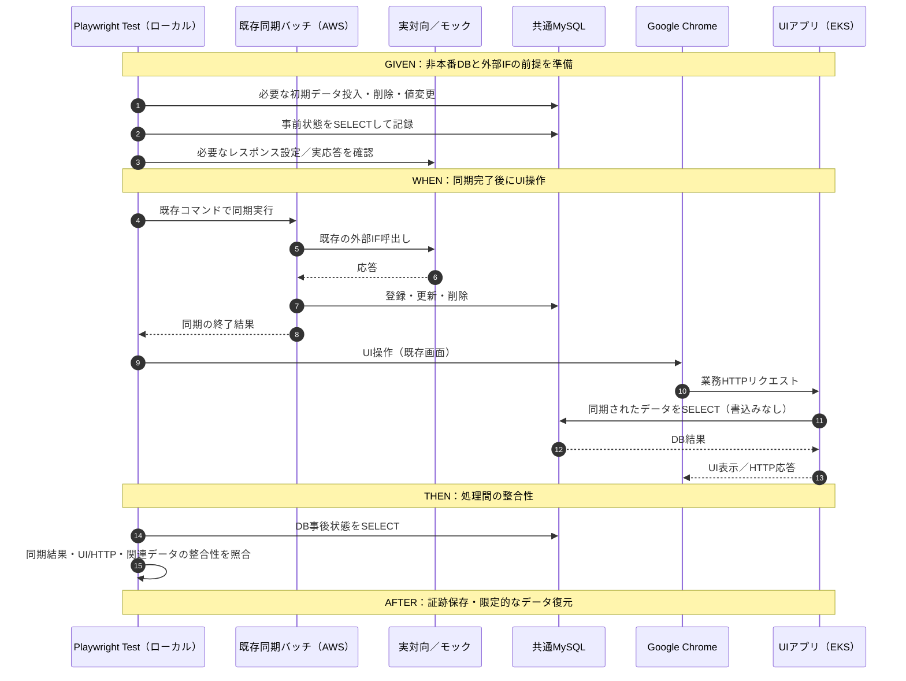
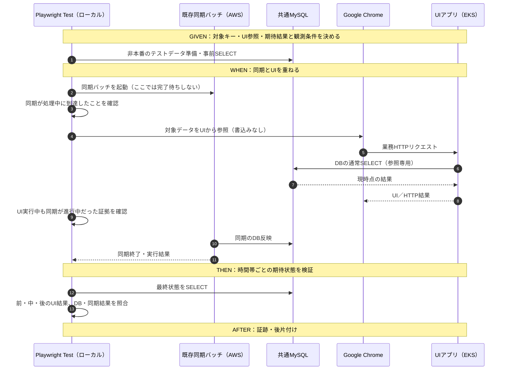
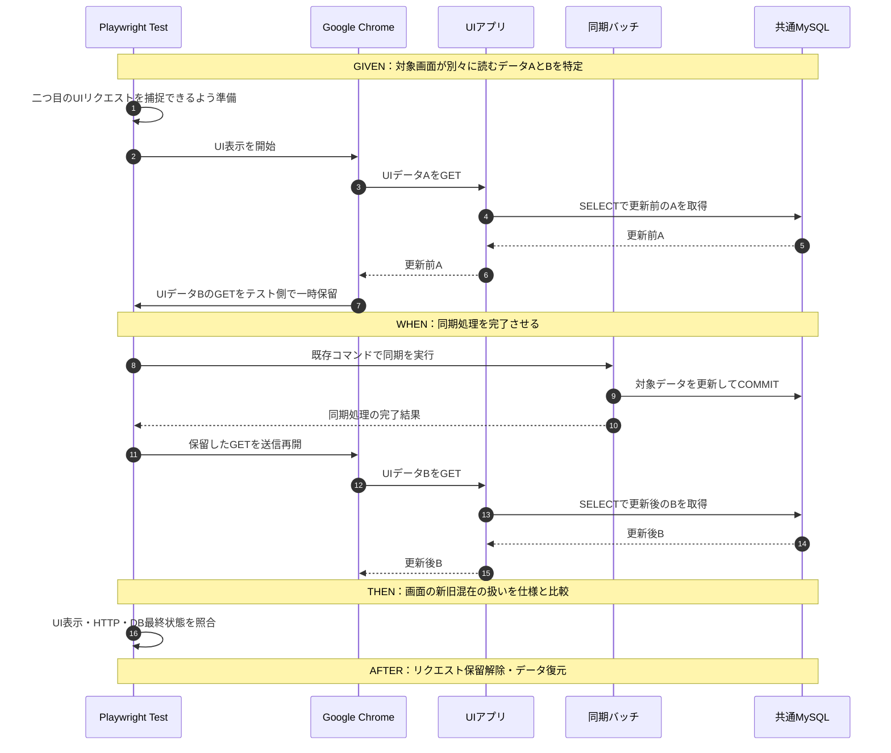

# 機能横断シナリオ試験・システム整合性検証方針

- 状態：**試験方針・候補シナリオの設計案**（実システムのコード・DDL・IF・業務期待動作に照らした確定および実行は未実施）
- 位置付け：個別機能の結合試験とは**別**の「機能横断・システムリスク検証」。業務E2Eに似た複数機能の実行経路を使うが、**網羅的な業務フロー検証を目的としない**。
- 前提資料：[個別機能の結合試験・大量データ照合方針](integration-test-strategy.md)
- 対象イメージ：**約250〜30,000件と幅がある同期バッチ**と複数データ集合、**同期対象データは参照のみのUI**、共通MySQL、AWS上のアプリ。UIは**別の業務データへPOST／PUTすることがある**。実際に存在する機能とデータ関係だけで具体化する。
- 原則：業務アプリ本体を試験専用に改修しない。既存の同期コマンドとローカルPlaywright Test／Google Chromeを用い、試験のための過剰な基盤構築はしない。

## 1. 試験目的と個別結合試験との違い

**問い：各機能が単独では正しく動いていても、機能同士が時間差・並行・部分失敗・不整合データを介して連携すると、意図しない結果にならないか。**

| 試験 | 主な問い | 観測の中心 |
| --- | --- | --- |
| 個別UI結合試験 | このUI操作と外部IF／DBが期待どおり連携するか | UI・HTTP・DB結果 |
| 個別同期バッチ結合試験 | 上流応答どおりにDBの有効データが揃うか／エラーを扱えるか | 終了結果・有効データ全件・論理／物理削除 |
| **本資料の機能横断シナリオ試験** | **バッチのDB更新前・中・後に参照専用UIが整合した情報を取得できるか、複数同期の部分失敗がUIへどう影響するか** | 時系列、複数機能の結果、DBコミット／読み取りの整合性、復旧 |

既存試験を長いE2Eに置き換えない。既存の個別試験を前提として、**その間にある見落としやすいリスクだけ**を少数のシナリオで拾う。

## 2. まず維持したいシステム上の不変条件

1. **同期完了後の整合性：** 正常完了した同期対象について、DBの**有効データ集合**は上流レスポンスに一致する。テーブルごとの論理／物理削除仕様を含む。
2. **関連整合性：** UIや他の処理が使う親子関係・参照関係が破綻していない。孤立行、間違った参照先、業務上同時に成立してはいけない状態を見逃さない。
3. **同期中のUI継続動作（必須）：** 同期データ参照時に**予期しない500・未処理例外・画面クラッシュ・操作不能**が発生しないことを優先する。**古いデータの正常表示は許容**する。業務仕様に沿ったエラー表示は予期しない画面停止とは区別する。
4. **失敗時の一貫性：** 一部同期や一部処理が失敗しても、意図しない「成功扱い」、気付かない部分更新、UIの誤った正常表示を起こさない。**全体ロールバックか部分確定かは実装・業務仕様で決め、試験側で勝手に仮定しない。**
5. **読取り一貫性と回復：** UIは同期対象データを参照するのみだが、取得した情報で**別の業務データをPOST／PUT**することがある。同期中のUI継続動作と、失敗後の同期データ整合性の回復を重視する。**古いデータを使ったPOST／PUTの検証は任意**とし、全面的な安全保証や一律拒否を本試験の要件にしない。
6. **試験の観測性：** シナリオで意図した実行順序／重なりを**証跡で確認できた場合のみ**合否を確定する。タイミングを作れなかった実行をPASSにしない。

上記は試験の評価軸。同期バッチは**クエリごとにCOMMIT**する前提。UIの表示が古いことだけでFAILとせず、予期しない画面停止・エラーを優先して検出する。**同期対象へのUI書込み競合は対象外**。古い同期情報を使う別業務へのPOST／PUTは個別仕様に応じて追加確認する。

## 3. 機能横断シナリオ候補（リスク起点）

**P0は今回確実に確認する試験テーマ**、P1は必要に応じて、P2は余力があれば実施する任意候補。ケースを機械的に増やさずリスクを重視する。**P0の試行は必須でも、同期中に参照できたことを証明できない実行はPASSにしない。**

| ID | 優先 | システムとして起き得る問題 | 実行順序・データの与え方 | Thenで確認すること |
| --- | --- | --- | --- | --- |
| SYS-01 | P0 | 同期は成功したのにUIが旧情報／削除済み情報を表示 | Given：同期前のDBとUI参照条件 → When：同期成功 → UI参照 | 同期後のUI／HTTP／DBが整合。キャッシュがあるなら許容期限と更新条件を確認 |
| SYS-02 | P0 | **複数の同期処理のうち一部だけ失敗**し、成功側と失敗側のデータが矛盾 | Given：関連する同期対象A/B → When：A成功・B失敗 → UI参照 | 失敗の識別、関連整合性、UIのエラー／利用制限／表示、期待する確定範囲 |
| SYS-03 | P0 | **同期データ間の不整合**で参照切れ・誤った紐付けが発生 | Given：親子キーの不一致や片側欠落などを再現 → When：関連する同期を実行 → UI参照 | 不整合の検出・許容／除外／失敗判定の仕様、孤立レコードや誤表示がないこと |
| SYS-04 | **P0（必須）** | **同期中にUI参照が画面停止・予期しない500・未処理例外を起こす** | Given：Chromeを参照直前まで準備 → When：同期のDB変化を検知してUI参照 → 完了後にも参照 | **予期せず画面が落ちないこと**。旧データ表示は原則許容。同期中の重なりが成立した証拠を記録し、不成立なら未確認 |
| SYS-05 | P1 | UIの複数の読取りが異なるコミット時点のデータを取得し、画面上の参照が破綻する | Given：関連する複数APIデータ → When：読取りAと読取りBの間に同期COMMIT | **予期しない500・画面停止の有無を優先**。表示上の新旧混在そのものは直ちにFAILとしない |
| SYS-06 | P1 | **単一の同期バッチ内部の途中失敗**で、半端なデータが残る | Given：複数テーブルにまたがる対象 → When：途中で失敗させる → UI参照 | ロールバック範囲または部分確定範囲、関連整合性、UIの失敗時動作 |
| SYS-07 | P1 | 部分失敗後の再同期で二重登録・削除漏れ・復旧不能 | Given：SYS-02／06相当の失敗後状態 → When：再同期 → UI参照 | 有効データの整合回復、重複ゼロ、論理／物理削除、成功結果の表示 |
| SYS-08 | P1 | **同期前から開いたUI画面のキャッシュが古いまま残る** | Given：UIが同期前データを取得 → When：同期完了 → 画面再読込／所定の更新契機 | 画面の更新規則に従って最新の有効データを参照できるか |
| SYS-09 | P1 | 正常な再同期で二重作成・再有効化・画面表示が変わる | Given：同期済み状態 → When：同じ対象を再同期 → UI参照 | 冪等性、有効キー集合・更新日時等の許容差、画面結果 |
| SYS-10 | P1 | 一方のリージョンから見たUIだけ更新後の状態が違う | Given：共有DBへ同期 → When：両アプリからUI参照 | 必要に応じたキャッシュ／読み込み反映の整合性。**ルーティング確率は試験しない** |
| SYS-11 | **P2（任意）** | 古い同期データを用いて**別業務データへPOST／PUT**する | Given：UIに旧データを残す → When：同期で元データを変更してから旧画面でPOST／PUT | 余力があれば不整合やエラー処理を確認する。**古ければ必ず拒否する等の要件はここで追加しない** |

**整理のポイント：**
- SYS-02は**複数の同期の一部が失敗**、SYS-06は**1つの同期の途中で失敗**。起こり得る構造と回復策が違うため分ける。
- SYS-03は**入力時点でデータ同士が整合していない**場合。SYS-04は**DB書換え中の単発参照**、SYS-05は**複数のUI読取りがCOMMITをまたぐ**場合、SYS-08は**同期前から開いた画面の更新**。それぞれ別のリスク。
- **UIは同期対象データを更新しない。** ただし別業務データへのPOST／PUTは存在する。同期対象への書込み競合は除外し、古い情報を使う別業務のPOST／PUTはSYS-11の任意候補とする。
- SYS-02／03／06の「異常」は**意図した失敗や業務上許容された制御になればシナリオ試験としてPASS**とする。アプリが異常状態を正常と誤認したらFAIL。

## 4. 典型的な実行シーケンス

### 4.1 同期完了後のUI操作（SYS-01、SYS-02、SYS-03、SYS-07）

- 異常系では**同期の失敗も期待結果として許容可能**。同期を実行したという事実だけでは合格しない。UI操作の前にどのDB状態が確定したかを確認する。
- 複数同期の一部失敗では、同期A／Bの**各終了結果**と同じ業務キーに対するデータの所属・参照関係を記録する。

### 4.2 同期処理中のUI参照（SYS-04、SYS-05）

**同期バッチは「コマンド自体は同期」でも、Playwright Testから子プロセス等で起動すれば、終了を`await`する前に別のUI操作を進められる。** 最後に同期の終了を待つ。現行バッチの実際の起動方法・エラー結果はコード確認後に確定する。

- **SYS-04の目的は、同期中のUI参照で予期しない画面停止がないこと。** 同期完了後しか参照できなかった実行は**未成立・未確認**として記録し、PASSにしない。
- 任意の`sleep`で約250件の短時間バッチのDB更新を狙うことはしない。**まずバッチのトランザクション境界とUIのSQL／API呼出し数を確認する**。外部IF応答待ちやDBロック待ちを作るだけでは、UIが部分更新を見たことの証明にはならない（4.3節）。
- **実バッチのDB更新区間とUI参照の重なりが客観的に確認できた場合のみ**SYS-04の成立とする。途中コミットの混在まで検証したと主張するには、その途中状態が実際に存在した根拠も必要。確認できなければ未成立として記録する。

SYS-04のDB更新区間は、対象同期の複数クエリの更新・COMMITとその間を含む期間であり、プロセス全体の外部GET待ちまで広げない。単一SQLの未コミット書込み瞬間との一致は求めない。単なるプロセス存命やUI参照前の1回の変化では成立せず、既存ログまたはUI参照期間内の複数DB観測で重なりを説明する。説明できなければ未確認とする。区間の重なりは、部分更新をUIが必ず実際に参照した保証とは区別する。

### 4.3 同期件数が約250件から3万件まで幅がある場合

**同期対象データについてUIは読取り専用。** 約250件〜3万件までの同期バッチがあり、**クエリごとにCOMMITされる**。途中のコミット済み状態がUIから見える可能性はあるが、短時間バッチは同時参照が成立しにくい。**長めのバッチからUIの参照試験を試行する**。古い表示は原則許容し、予期しない画面停止を重点的に確認する。

**実施上の優先方針：** ①バッチのCOMMIT境界とUIの読み取り方式を既存コードから確認 → ②リスクがあるならChromeを操作直前まで準備し、バッチ起動後、限定したDBデータを軽量SELECTで監視 → ③変化が見えたらすぐPlaywrightでUI参照を実行し、バッチ・DB・UIの時刻を記録する。**ただし、通常のSELECTで変化を検知できるのは基本的にCOMMIT後**。UI参照前の1回の変化だけでは更新区間とUI参照の重なりの証拠にならない。既存ログやUI参照期間内の複数DB観測でも説明できなければ**未確認**として扱う。試験用の大がかりな遅延・ロック・計測機構は追加しない。

| 実装構造 | UIが見得るデータ | 優先する検証 |
| --- | --- | --- |
| **クエリごとにCOMMIT（今回の実装前提）** | 途中まで更新したコミット済みデータがUIから見える場合がある | 長めのバッチでDB変化の検知とUI参照を試し、予期しない画面停止・エラーを確認する |
| **UIが複数の独立したAPI／SQLで取得し、その間にバッチのCOMMITが入る** | UIの読取りAは更新前、読取りBは更新後となり、画面のデータが異なる時点にまたがる可能性 | **読取りA → バッチのCOMMIT → 読取りB** の順序が実装上生じ得るか確認。画面停止リスクがある場合のみ追加試験（SYS-05） |
| **短いバッチ（約250件）** | DB更新が短時間で終わり、UI参照を重ねられないことがある | Chromeを操作前に準備して試行する。成立しなければ**未確認として残し、複雑な時間制御は追加しない** |

**注意：** 「バッチを1回実行する」ことは「1つのDBトランザクション」を意味しない。MySQLは通常autocommitが有効で、明示的なトランザクションがなければSQLごとにコミットされる。InnoDBの通常の一貫性SELECTは未コミット変更を見ないが、**UIが複数の別クエリ／別APIで読めば、それぞれ異なるスナップショットになる可能性は残る**。分離レベルやUIのDB接続方式を確認する。

#### 再現性を優先する例：画面の複数読取りの間に同期COMMITを挟む

- 上の例は**画面が複数の独立したHTTPリクエストでデータを取る場合に限る**。Playwrightのリクエスト制御で二つ目の送信を待たせる方式を想定し、**業務アプリは変更しない**。この試験は「UIの複数読み取りの間にCOMMITを挟む」ものであり、**バッチのDB書込み中の一瞬を再現したものではない**。
- UIが単一API・単一SELECTで必要データを取得するなら、この手法は成立しないため無理に採用しない。複数SELECTが1つの読取りトランザクションに属するかも確認する。**更新前と更新後の混在を許容するかは業務仕様で定める**。
- 複数コミットで途中状態があり得る場合は、まず**到達可能な途中のDB状態を非本番のテスト用キーで再現し、UIが参照したときに破綻しないか**を試験する。ただし手動で作った状態へのUI試験は、**実バッチがその状態を実際に公開した証明にはならない**。実バッチ中の試験は再現可能な観測・制御手段が得られた場合に追加する。
- **行ロックを追加してバッチを待たせるだけでは不十分。** それは「書込みがブロックされた状態」を作るもので、部分更新がCOMMITされてUIから見えることを証明しない。UIは参照のみなので、書込み競合を優先目的にはしない。
- タイミングを作れない実行はPASSにせず、**未成立／未確認**として区別する。非本番DBの限定キーだけを用い、失敗時の解除・データ復元を行う。

技術的な前提はMySQL公式の[一貫性読取り](https://dev.mysql.com/doc/refman/8.4/en/innodb-consistent-read.html)と[COMMIT／autocommit](https://dev.mysql.com/doc/refman/8.4/en/commit.html)による。実際の分離レベル・DBエンジン・SQL構成は既存実装から確認する。

## 5. Given / When / Then / After の試験ケース共通形式

| フェーズ | 決めること |
| --- | --- |
| **Given** | 対象の業務キー、同期A／B、上流の入力条件・モック条件、DBのINSERT／UPDATE／DELETE、前提となるUI状態、変更前後のSELECT、試験対象データの退避 |
| **When** | 同期A→B→UI、同期A成功＋B失敗→UI、同期中のUI参照、UIの複数読取りの間に同期COMMITなど、**実行順序と重なり方** |
| **Then** | バッチ終了結果、UIのHTTP／表示、操作後のDBと事前状態との差分、論理／物理削除、キー・値・関連、失敗検知・回復、タイミングの成立 |
| **After** | モック設定を試験前の状態に戻す。必要なテストデータを復元する。各処理の終了を回収し、証跡・未確認範囲を保存する |

**最小のケース記録：** ケースID／対象キー／関与機能／想定障害／Givenの事前条件／Whenの順序／Thenの明示的な期待値／After／根拠（UI・HTTP・DB・バッチ結果・時刻）／判定（PASS・FAIL・判定保留）。

## 6. 実装時に先に確認すること

下記は原則として**実装・DB定義・IF仕様から読み取り、試験ケースに落とす作業**。調査自体を大きな先行プロジェクトにしない。ただし、コードだけで決まらない業務上の許容状態は人間が判断する。

1. **連携する機能とデータの接点：** どの同期がどのテーブル／キーを作り、どのUI機能が読むか（UIは参照のみ）。複数同期の依存関係（AのマスタをBが参照する等）。
2. **整合性と読取り方法：** バッチは**クエリごとにCOMMITする**前提。UIのSQL・API数、キャッシュや再取得契機、画面停止し得る依存関係を調べる。同期対象データのUI書込み競合は対象外。別業務へのPOST／PUTは任意の検証候補。
3. **部分失敗の境界：** バッチ間・テーブル間・処理単位のトランザクション／確定タイミング。エラー時に全体ロールバックか一部確定か、既存の終了結果で何を把握できるか。
4. **試験刺激の現実性：** 約250〜30,000件のバッチでDB変化を軽量に監視し、準備済みChromeで参照を試行する。実際のDB更新中にUI参照が成立した証拠が取れなければ未確認とし、アプリ改修や重いタイミング制御の追加は前提としない。
5. **観測点と隔離：** 検証環境でDB操作が許可される範囲、同期とUIの同時実行、テスト前後のDB状態と復元方法。共通DBへの破壊的操作は**限定した非本番キー**のみ。
6. **再現・判定：** 並行ケースはバッチとUIの実行重複を客観的に確認する。順序条件が満たされなければ合否判定を保留。上流データ変化は個別試験のハッシュ比較方針に従う。

## 7. 導入順序と完成条件

1. **SYS-01：** 同期後のUIが正常動作することを確認する。
2. **SYS-02／03：** 一部同期失敗や同期データ不整合とUI参照を組み合わせ、システムが予期せず落ちないか確認する。
3. **SYS-04（必須）：** 約250〜30,000件のバッチのうち、まずDB更新を観測しやすいものを選び、変化を検知して準備済みのChromeから参照する。**予期しない画面停止・HTTP 500・未処理例外の有無**を重点確認する。同期中の参照が成立しなければ未確認として残し、PASSにしない。SYS-05は複数API参照に起因する画面停止リスクがあれば追加する。
4. **SYS-11（任意）：** 古い同期情報を参照したまま、別業務にPOST／PUTするケースは余力があれば行う。**今回の必須受入条件に含めず、サーバーの一律拒否を仕様として追加しない**。その他の候補もリスクと工数に応じて選ぶ。

**完成の考え方：** 実行したシナリオは前提・操作順序・UI／HTTP／DBの結果・未確認範囲を記録する。**SYS-04は必ず確認に取り組み、成立を観測できた範囲のみPASS／FAILを判定する。** 再現できなかった場合は未確認と明示し、成功と主張しない。**任意のSYS-11を実施しなくても、今回の必須受入条件には影響させない。**

**現状の制約：** 本資料は試験方針と候補シナリオであり、実バッチとUIの同時実行・実AWSでの検証は未実施。業務アプリ本体の改修は前提にしない。
