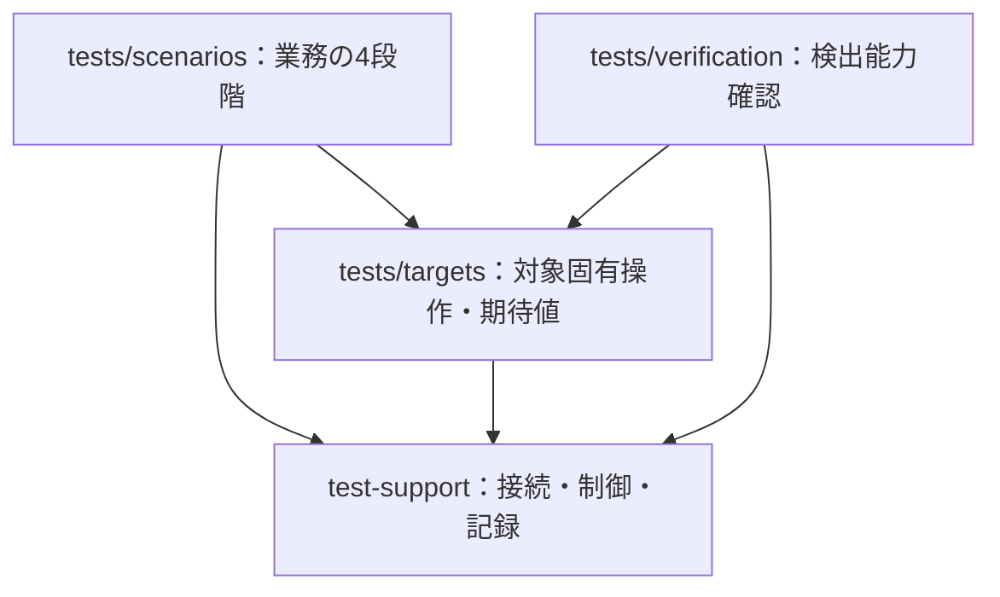

# ディレクトリ構成と責務

状態：**0ベースの配置提案。以下のファイル・APIは未実装であり、現行コードの所在を示さない。** 実際の移動・削除・作成は別作業とする。

根拠となる[責務と4論点](repository-foundations.md)、実装時の[依存・復元・判定ルール](design-and-implementation-rules.md)と合わせて読む。試験の分類は[既存サマリー](integration-test-overview-onepage.md)を正本とする。

## 1. 配置の全体像

| 配置案 | 置くもの | 置かないもの |
| --- | --- | --- |
| `docs/` | 試験目的、設計判断、実行・復旧手順 | 実行結果を仕様に見せる記述 |
| `tests/scenarios/ui/` | UI個別ケース。実接続正常・モック異常 | 全UI共通の業務操作 |
| `tests/scenarios/batch/` | 同期バッチ個別ケース。実接続正常・モック異常 | 汎用コマンド起動機構 |
| `tests/scenarios/cross-feature/` | 複数同期とUIの順序・並行を表すケース | 他ケースの実行を呼び出すコード |
| `tests/targets/<対象名>/` | UI操作、バッチ引数、SQL、データ準備、期待値・照合規則 | 接続管理や汎用証跡ライターの複製 |
| `tests/targets/<対象名>/data/` | Git管理する小さい合成fixture・期待JSONサンプル・準備SQL。複数ケースで共有する対象固有データ | 実上流レスポンスやDBの生の退避データ |
| `tests/scenarios/<分類>/<ケース名>/data/` | Git管理する、そのケース専用の合成入力・期待サンプル・SQL。単独ケースからのみ参照 | 他ケースへ暗黙に共有するデータ |
| `test-support/` | 環境確認、ブラウザーの寿命管理、DB接続、コマンド起動、HTTP取得、モック制御通信、比較・差分抽出・判定記録、証跡保存 | locator、テーブル名、業務項目対応、比較キー・NULL・許容差、ケースの期待値 |
| `tests/verification/` | 共通基盤・対象固有の検証器の故障注入と局所的な結合確認 | 業務試験全体の再実装 |
| `mocks/status-mock/` | 管理APIと制御可能な外部IF代役 | ケースごとの応答選択や実アプリの実装 |
| `demo/` | 代役アプリ、デモDB、デモ専用のinfra・配置ファイル | 将来の業務アプリ・実環境インフラの所有 |
| `config/environments/` | 対象環境を明示する設定のひな形 | 秘密値や実データ |
| `.local/`（Git対象外） | `runs/<runId>/` の証跡、`snapshots/<runId>/` の一時取得データ・復旧用退避 | ソースや恒久的なデータ保管 |

SSO用の認証状態は `.local/auth/<環境>/<主体別名>/` 等の本人限定・Git対象外領域へ分離し、証跡／スナップショットへ混ぜない。認証準備の入口は業務ケースの検出対象から外す。将来の共通基盤は資格の寿命管理を、対象固有側はログイン完了・主体確認を、ケースは要求ロールと認証異常の期待値を持つ。具体的な候補とケース境界は[SSO実行仕様](sso-local-execution.md)に従い、現行配置を今回移動しない。

表は責務の置き場所であり、空の将来フォルダを先に作る指示ではない。`test-support/` 内の細分化や別パッケージ化も、実装量と実際の重複が生じてから判断する。実接続用とデモ用の環境設定を区別し、デモの動作を実対象の合格実績に数えない。

ブラウザーの起動・終了は標準fixtureを優先する。比較・差分の共通化も、必要な小さい処理を実例から抽出する範囲とし、汎用比較エンジンの新設を要求しない。

合成データは想定する境界値と期待結果を説明できる最小量にする。実上流の全量生データ、DB退避、実行証跡は `.local/` 配下で扱い、Gitへcommitしない。SQLは対象側のソースとして管理するが、実行時の秘密値・実データを埋め込まない。

この案では読みやすさと入力・結果の型確認のためTypeScript（`.ts`）を採用候補とする。現行のCJSに準拠した移行案ではなく、実装時に実行環境・既存ツールとの適合を確認して確定する。

## 2. ファイルの分け方と依存

対象名 `reference-data` は配置を説明する**仮称**。実機能を調べて業務で通じる名前へ置き換える。複数機能のケースでは必要な対象モジュールを組み合わせ、汎用の「横断対象」を新設しない。

| 設計例のファイル | 内容 |
| --- | --- |
| `tests/targets/reference-data/ui.ts` | 画面へ移動、参照操作、locator、表示・HTTPの観測 |
| `tests/targets/reference-data/batch.ts` | 既存起動コマンドと引数、既存終了結果の解釈 |
| `tests/targets/reference-data/db.ts` | 対象を絞るSQL、有効行・親子関係、上流相当JSONへの復元 |
| `tests/targets/reference-data/prepare.ts` | 許可範囲の退避・投入・復元と、その成立確認 |
| `tests/targets/reference-data/upstream.ts` | 上流URL・条件、取得メタデータ、対象同一性の根拠 |
| `tests/targets/reference-data/expectations.ts` | 期待表示、全件照合の項目対応、削除・NULL・順序の規則 |
| `test-support/db.ts`、`process.ts` | 接続・パラメーター受渡し、起動・期限・終了回収 |
| `test-support/http.ts`、`mock-client.ts` | HTTPの完全取得、モック管理・実応答確認の通信 |
| `test-support/environment.ts`、`evidence.ts` | 実行環境の照合、結果・証跡の追記と保存 |

この分割も必要な規模になった時の例であり、1つの業務操作を機械的に多数ファイルへ分解しない。単一ケースだけが使う短い処理はケースの近くに置ける。複数ケースで同じ業務知識を使うときに対象モジュールへ切り出す。

矢印はソースコード上の依存を示す。`test-support` から `tests/targets`・`tests/scenarios`・`demo` をimportしない。モックとデモはHTTP・DB・既存コマンドで接続する実行対象であり、ケースへ実装モジュールを直接importしない。モックをデモに配置するための定義は `demo/` に置き、モック本体と分ける。

## 3. 代表ケースで配置を通す

以下は**設計例・未実装**。ファイル名・呼出し名は実在APIではない。各ケースは通常の試験コードで4段階を明示し、宣言DSLに変換しない。事前期待値を実測結果から後付けしない。

### 3.1 UIモック異常

入口：`tests/scenarios/ui/external-error.spec.ts`。`targets/reference-data/ui.ts`・`prepare.ts`・`db.ts`・`expectations.ts` と、共通の `mock-client.ts`・`environment.ts`・`evidence.ts` を呼ぶ。DBを変更しないケースでは退避・復元を省略する。

| 段階 | ケースから読める業務内容 | 呼び先の責務 |
| --- | --- | --- |
| Given | 実行環境・許可範囲確認。期待するエラー表示・HTTP・DB条件を固定。両モックの元設定を退避し503へ変更、実応答を確認。必要なデータ準備とWhen直前SELECT | 共通部はモック通信とDB接続。対象側は画面・SQL・準備条件を知る |
| When | Chromeで外部IFを利用する既存画面操作を実行 | 対象UIがlocatorと必要な業務HTTPの観測を持つ |
| Then | 期待したエラーが実際に表示される。HTTP・必要なDB非更新が仕様どおり | 表示・差分の業務期待値は対象側、判定の組立てはケース |
| After | 変更したモックを各々の元設定へ戻して確認。所有するデータを必要な範囲で復元し、証跡確定 | 復元結果と元の試験判定を別々に保存 |

証跡：両モックの事前・変更後・復元後、UI表示、HTTP、必要なDB前後、期待値と差分。期待異常処理が成立すればPASS。503の設定・実応答を確認できなければ未確認（基盤／前提）、画面が期待と違えばFAIL。復元失敗時は元の判定を保ったまま実行全体を正常完了にしない。

### 3.2 同期バッチ実接続・全件照合

入口：`tests/scenarios/batch/full-import.spec.ts`。`targets/reference-data/upstream.ts`・`batch.ts`・`db.ts`・`prepare.ts`・`expectations.ts` から、共通の `http.ts`・`process.ts`・`db.ts`・`evidence.ts` を使う。Chromeは起動しない。

| 段階 | ケースから読める業務内容 | 呼び先の責務 |
| --- | --- | --- |
| Given | 許可された対象環境と全量同期の書込み範囲を確認。上流の単一GETを完全保存・解析。必要なら限定キーを削除／投入／誤値化し、変更前退避とWhen直前の比較基準を分けて保存 | 対象側は取得条件・SQL・復元計画、共通部は転送・接続・ファイル保存 |
| When | 既存コマンドで同期を実行し、終了と既存業務結果を回収 | `batch.ts` が成功条件を解釈。起動機構は終了コードだけで業務成功にしない |
| Then | DB有効行を上流相当JSONへ復元し、全対象のキー・値・親子・削除状態を照合。差分時だけ上流再GET・ハッシュ比較で切分け | 項目対応・NULL・配列順・BIGINT精度は対象側。取得失敗や同一対象性の限界も残す |
| After | 実処理の終了確認後、所有範囲のデータを計画どおり復元・確認。差分要約を保存し、一時上流データを削除 | 全量同期で変わったDBを無条件で旧状態へ戻さない |

証跡：取得条件・期間・件数・バイト数・ハッシュ・解析成否、バッチ結果、DB照合範囲、欠落／重複／余剰／宛先／値／関連／削除差分、未確認範囲、復元状態。終了正常でも有効な不一致はFAIL。取得不完全・照合不能・取得条件や対象範囲が不明で比較自体が妥当でない場合は未確認。一致時のPASSは定めた保存スナップショットとの照合に限り、実バッチが同一入力を取得した保証とは分ける。前後ハッシュによる根拠と限界も別記する（[詳細](integration-test-strategy.md#52-上流データの変化はローカル保存レスポンスのハッシュで比較する)）。

### 3.3 同期中のUI参照

入口：`tests/scenarios/cross-feature/read-during-sync.spec.ts`。前2例の対象UI・バッチ・DB操作と共通機構を組み合わせる。タイミングを作るために業務アプリを改修しない。

| 段階 | ケースから読める業務内容 | 呼び先の責務 |
| --- | --- | --- |
| Given | Chromeを参照直前まで準備。対象キー、バッチのCOMMIT境界、観測方法、期限、終了回収・復元手順を決める | 対象側がどのDB変化とUI参照を結び付けられるか定義 |
| When | 同期を開始し、完了待ちと並行して軽量DB観測・準備済みUI参照を実施。その後バッチとUIを回収 | ケースが並行の順序を明示。プロセス制御だけでは重なりを認定しない |
| Then | DB更新区間とUI参照の重なりを証拠から判断し、想定外のクラッシュ・500・未処理例外・操作不能がないか確認。完了後も参照 | 古い表示のみではFAILにしない。成立条件とUI結果を別々に記録 |
| After | バッチ／ブラウザーの終了を確認し、モック・データの限定復元、時系列と判定を保存 | 中断時も子プロセスだけの停止でAWS側処理停止を断定しない |

証跡：バッチ・DB観測・UI参照の時系列、観測条件、重なりの根拠、HTTP／画面例外／操作結果、最終DB、復元状態。250〜30,000件・クエリ単位COMMITを前提とし、確認したいのはクエリ間を含む同期更新期間のUI継続であって、単一SQLの書込み瞬間ではない。成立例と限界は[観測ルール](design-and-implementation-rules.md#4-観測と照合)を参照。成立すれば観測したUI結果をPASS／FAIL、簡易試行でも説明できなければ未確認。明確に観測した画面障害は別の不具合所見として残す。複数読取りの間にCOMMITを挟む試験も、実バッチ更新中の証明と混同しない（[詳細](cross-feature-system-scenarios.md#43-同期件数が約250件から3万件まで幅がある場合)）。

## 4. 導入時の単位

UIモック異常を前提確認から復元・証跡まで小さく完成 → 実接続バッチを全件照合まで完成 → 同期中UIで観測と並行回収を追加する。各段階で必要な共通機構だけを抽出する。この3例は構成を評価する代表経路であり、UI実接続正常・バッチモック異常・他の必須横断テーマの実施を代替しない。
