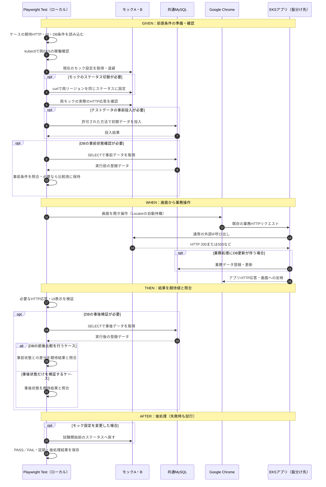
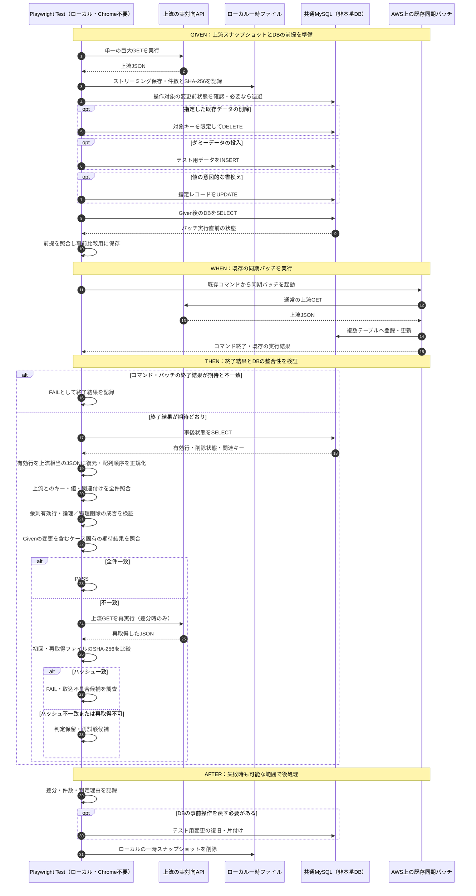
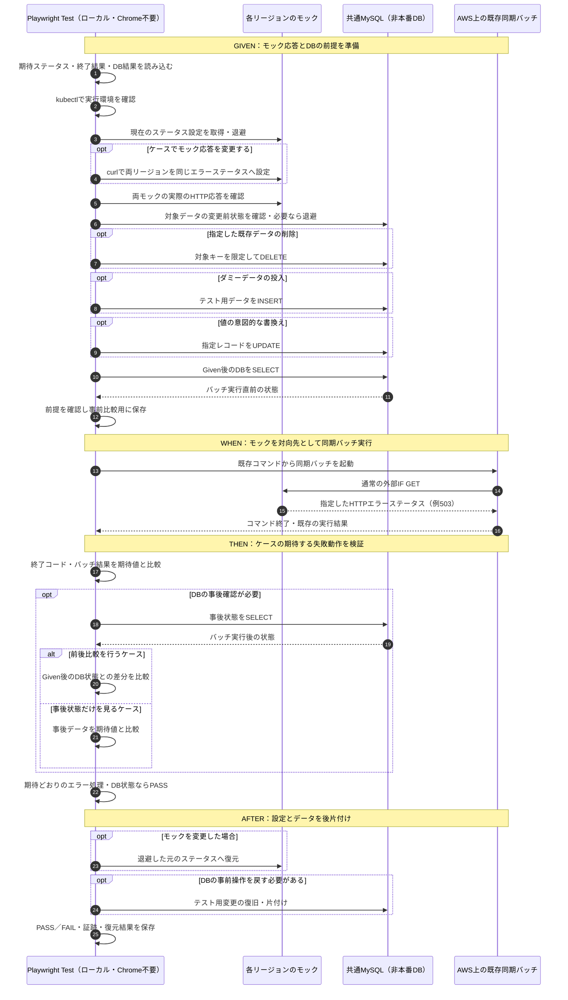

# 結合試験の目的・設計方針と大量データ照合の試験計画

- 状態：**試験方針の合意・設計案**（実対向・本番相当データの照合実装は未着手）
- 整理日：2026-10-30
- 対象：`play-right-demo`。この文書を試験目的と完成判定の基準にする。現行デモの仕様・実装状況は別途README／コードを参照する。
- 原則：**試験のために業務アプリ本体を変更しない。ケース数を増やすことを目的にしない。**

## 1. 目指すもの

既存のアプリケーションテストでは見つけにくい、**実稼働環境に近いAWS・外部システム・実データとの結合による想定外の不具合**を検出する。

### 目的A：モックのHTTPステータスに対する振る舞いの確認

外部システムを模したモックのレスポンスを200／503等に設定し、**UI操作または同期バッチ実行後**に、必要な**アプリのHTTP応答・UI表示・バッチ実行結果・DBの更新／非更新**が仕様どおりかを確認する。

- テストケースごとにモックの設定を変更する場合と、変更しない場合がある。
- 両リージョンのモックは**同じステータス**に揃える。
- 操作前に両モックが指定どおりのHTTPステータスを返すことを確認する。
- UI試験では期待するエラーメッセージが**実際に画面上へ表示されるか**を必要なケースで合否対象にする。同期バッチ試験では**既存コマンドの終了結果とDBへの影響**を中心に検証する（Chrome不要）。
- 既存ログや通信の途中を細かく証明することは基本目的ではない。調査に必要な場合にのみ使用する。

### 目的B：実対向のデータを用いた大量取り込みの整合性確認

上流システムから**数万件規模**の実データを取得する処理について、正常終了したというだけで合格にせず、**本来入るべきレコードが、正しいテーブル・正しい値・正しい親子関係で登録されているか**を全件照合する。

今回、特に発見したい問題は「処理はエラーにならなかったが、上流IFの実態が想定と異なり、実は一部が未登録・誤登録だった」というもの。

- **同期仕様：上流レスポンスを正として、同期対象のDB有効データを常に同じ状態へ揃える。** 上流にないデータはテーブルごとの仕様で論理削除または物理削除する。有効データのDB復元JSONと上流JSONの全件一致をゴールとし、削除済み履歴やDB独自管理列を区別する。
- 取込先は複数の正規化テーブル。
- 少なくとも**数値計算による変換はない**という認識。直接転記が中心で、あっても文字列結合程度を想定する。ただし実コードの確認までは**未確定**。
- 詳細設計書・項目マッピング仕様書は存在せず、ルールの手掛かりは主に実装コード、上流JSON、テーブル／カラム名にある。
- テスト側で取込処理全体を再実装するのではなく、**DBの正規化構造を比較用のJSONに復元して、取得した上流JSONと比較する**ことを第一候補とする。

## 2. 今回の試験対象「ではない」もの

- 一般的なE2Eの網羅性や大量のUIシナリオの追加。
- 2リージョンへのランダム振分けアルゴリズムや確率の妥当性。これは**環境上の制約**であり、検証したい業務仕様ではない。
- 業務アプリへの検証専用HTTPヘッダー・ログ・コードの追加。
- HTTP通信の途中に観測プロキシを置いて、受信処理の内部を厳密に証明すること。
- 既存アプリケーション単体テストの大量の再実行。

**留意点：** 現行デモには `x-external-status` やリージョン識別ヘッダーに依存する結合試験が残っている。これらは**デモ固有の実装**であり、将来の実アプリへの適用条件にはしない。共通試験基盤へ汎用化する時点で依存を除去すること。

## 3. 環境の扱い

- AWS上に2リージョン、それぞれアプリPodとモックPodを置く。MySQLは**共通のDB**を利用する。
- リクエストはどちらのリージョンに飛ぶか分からない。**どちらでも同じ期待結果が成立する**ようにテスト前提（モック応答など）を揃える。
- 各リージョンのPod稼働・到達可能性の確認は、試験前の**環境チェック**として扱う。振分けが実際に50:50かの判定は行わない。
- **Playwrightは手元のローカルPCで実行し、インストール済みのGoogle Chromeを使用する。** AWS（EKS・共通RDS・モック／実対向）は試験対象・接続先であり、Playwrightの実行場所ではない。`kubectl`、`curl`、MySQL照会も原則として手元PCから実行する。
- 現行デモのランダム入口はローカルルーター＋`kubectl port-forward`。AWS上の本番相当ルーティングそのものを検証しているわけではない。
- AWS構築・実機実行には料金が発生する。**この文書の追加自体はAWS環境の作成を伴わない。**

## 4. 目的A：少数のモック試験ケース

以下は実装例であり、実際のアプリのHTTPコード・表示文言・DB期待結果は業務仕様に合わせて確定する。

| ケース | モックA／B | 確認すること |
| --- | --- | --- |
| 正常 | ともに200 | 期待する正常UI／HTTP応答。必要ならDB登録内容 |
| 異常 | ともに503 | 期待するエラーUI／HTTP応答。必要ならDBが更新されていないこと |
| 切替なし | 変更しない（指定の事前条件を確認） | 同じ業務動作が成立すること |
| **同期バッチ異常系** | 両方503等のエラーステータス | **バッチの終了結果とDBの状態／前後差分**が仕様どおり（バッチ試験ではUI確認不要） |

**UI試験はGiven / When / Thenで整理し、設定復元などはAfter（後処理）として分ける。** 各条件はテストケースごとに必要なものだけを選ぶ。

1. **Given（前提条件）**：両EKSの稼働確認、モック設定の退避と必要なステータスへの切替、両モックの実応答確認。さらに**必要なテストデータの事前投入**、**DBの実行前状態確認**を行う。後で差分を見るケースでは事前状態を比較用スナップショットとして保持する。
2. **When（操作）**：ローカルPlaywrightでGoogle Chromeを操作し、既存アプリの業務操作を実行する。
3. **Then（結果検証）**：UIの表示内容・必要なアプリHTTP応答を確認し、ケースに応じてDBの事後状態を取得する。**事前データがある場合は前後の差分を期待値と比較し**、事後状態だけを確認するケースではその期待値と比較する。
4. **After（後処理）**：変更したモックのステータスを**試験開始前の値**に戻し、証跡と結果を保存する（失敗時も復元を試みる）。投入したテストデータの片付けは、必要な場合に別途定めた安全な方法で行う。

**モックが503を返すことが確認でき、UIも期待どおりだった**という結果は結合試験として価値がある。ただし、アプリ内部の「503を正しく読み取った瞬間」までは直接観測していないことを明示する。

## 5. 目的B：実データ取り込み試験の進め方

### 5.1 試験前に上流データを1回取得して保存する

現行システムは**巨大なレスポンスボディをログへ出さず、処理後に保持しない**方針。そのため、アプリ実行時のログから取込元の実データは復元できない。

- **上流IFはページングなしの単一GETで数万件をまとめて返す**ことを前提とする。一連の試験の開始前に既存の対向IFを別途呼び出し、その**1回のGET応答全体**をスナップショットとして保存する。ページ番号や次ページトークンの制御は不要。
- 巨大なレスポンスはメモリへ全量展開せず、可能な限り**ストリーミングで一時ファイルへ保存**する（HTTP転送のチャンク分割はAPIのページングではない）。取得成功と応答全体の保存・JSONとしての解析成功を確認してから確定ファイルへ切り替える。途中切断、タイムアウト、JSON不正などは取得失敗として扱い、不完全なファイルを基準データにしない。
- 取得時の**HTTPステータス、取得開始／終了日時、リクエスト条件、保存バイト数、SHA-256ハッシュ、JSON内の対象件数、取得・解析成否**をメタデータとして記録する。取得件数が取得できない／解析できない場合は、成功とみなさず未確認範囲を残す。
- 単一GETがHTTP 200で完了しても、上流側が途中までのデータを整形式のJSONで返す等の可能性はゼロではない。仕様上の期待件数など独立した確認手段がなければ、**取得対象の完全性には限界がある**ことを明記する。
- **対象データは社内公開情報のみで、マスキングを必要とする情報は含まれない**という前提を採用する。保存先は社内管理の手元PCにあるGit管理対象外の `.local/snapshots/<run-id>/` とし、一時保存する。S3等の新たな保管基盤、特別な暗号化設定、データ用の個別承認フローを本試験の追加要件とはしない。社内端末の通常のアクセス管理・運用ルールに従う。
- 取得成功後はスナップショットを**一連の試験で再利用**する。再取得は上流データ変化の調査など必要な場合に限る。データはローカルで扱い、GitHubのソース管理や外部公開レポートには含めない。
- スナップショットは**一時ファイル**として扱い、試験終了後に通常のローカル作業ファイルと同様に削除する。特別なマスキングや個別の保管期間審査は前提としない。**API認証情報だけはデータとは別に管理し、GitHub・ログに記録しない。**
- この保存データは、**期待する入力の観測値**であって、アプリが別途取得したデータと必ず同一だったことの証明にはならない。

### 5.2 上流データの変化はローカル保存レスポンスのハッシュで比較する

上流には変更日時・バージョン・ETag等がない。更新間隔は概ね数時間と考えられるため、**DB照合に差分が出た場合にだけ、上流レスポンスのハッシュ値を比較して切り分ける**。特別な変更検知基盤やバッチIDを新設しない。

1. **試験開始前**：単一の巨大GETのレスポンスをローカルに保存し、ファイルのSHA-256を記録する（基準ハッシュ）。
2. **同期バッチ終了後**：保存済みレスポンスとDB復元結果を、業務キー／値／関連付けで全件照合する。一致すればPASS。
3. **差分が出た場合のみ**：同一エンドポイント・同一条件で上流GETを再実行し、別の一時ファイルに保存してSHA-256を計算する。**元の保存済みファイルと新しく取得したファイルのハッシュを比較する。**
4. **ハッシュ一致**：少なくとも取得した前後2時点のレスポンスはバイト単位で同じ。不一致はアプリ／DB側の不具合候補としてFAILを維持して調査し、必要なら再試験する。
5. **ハッシュ不一致**：上流データ変更の可能性あり。DB不一致を直ちにアプリの不具合と断定せず、**判定保留・再試験対象**とする（自動PASSにはしない）。再取得できない場合も判定根拠不足として記録する。

**注意：** 保存済みファイル自身のハッシュをもう一度計算するだけでは、上流システムのデータ変化は分からない。ハッシュ比較には**上流から再GETしたレスポンス**が必要。また、生JSONのSHA-256は項目や配列の順番、空白だけが変わっても変化する。配列順は業務上意味がないため、ハッシュが異なる場合もデータ内容の変更を証明したことにはならない。必要時だけJSONの意味的な比較で確認する。

前後のハッシュが一致しても、実アプリが途中で取得した内容と同一だったことや、一時的な変更がなかったことまでは証明できない。元のFAILと再試験結果はそれぞれ保存する。

### 5.3 GivenでDBを準備してから同期バッチを実行する

- **Given（前提条件）**で、ケースに応じて**対象レコードの削除（DELETE）、ダミーデータの投入（INSERT）、既存レコードの値の意図的な書換え（UPDATE）**を行う。操作が不要なケースでは省略する。
- 更新前の対象データを必要な範囲で退避し、操作後にSELECTで**Givenが成立したことを確認**する。DB前後比較をする場合の基準は、**事前操作が終わった後、バッチ実行直前の状態**。変更前の退避データは後処理の復旧に利用できる。
- DELETE／INSERT／UPDATEは**許可された非本番DBの対象範囲**に限定する。照合用の読み取り専用権限とは分離し、対象キー・影響範囲・必要なら参照関係・復旧方法を確認する。業務データの無条件全件削除はしない。
- **When（試験対象の実行）**では実アプリの**既存の操作・API・同期バッチ起動方法**を使う。検証用の特別な登録経路をアプリに作らない。
- **今回の取り込みバッチはLambdaのような処理をコマンドから同期呼び出しする想定。** 手元の実行では、コマンドが終了してプロンプトに戻れば処理が完了している認識のため、**正常終了が確認できた直後にDBを照合する**。非同期ジョブのポーリングや固定秒数のスリープは標準手順に加えない。
- ただし、**コマンド終了と業務処理の成功は区別する**。既存コードから呼び出しが実際に完了まで待つ方式か確認し、終了コードに加えて既存の応答・エラー情報を判定する。AWS Lambdaの`Invoke`を使っている場合は`RequestResponse`（同期）と`Event`（非同期）を区別し、HTTP/CLI成功だけでなく`FunctionError`や戻りペイロードも確認する。いずれの場合も、最後はDB全件照合で「正常終了したが未登録」を検出する。
- **Then（結果検証）**では同期コマンドの終了結果とDBの事後状態を確認し、**上流の同期対象データとDBの有効データが全件一致すること**を照合する。Givenで削除した上流内のキーは再登録され、意図的に変えた値は上流に合わせて修正される。上流に存在しないダミー行は有効なまま残らず、**テーブルの仕様に応じて論理削除（無効化）か物理削除（行の消滅）**が行われることを確認する。
- **After（後処理）**では証跡を保存し、必要ならGivenのデータ変更を復旧・削除する。失敗時も安全な範囲で実施する。
- **本件の上流データは社内公開情報でマスキング不要**という前提で、実アプリの通常の取り込み経路から検証する。非本番DBへの投入も社内の通常の環境運用に従い、特別な匿名化データの準備は行わない。

### 5.4 DBから「上流JSONに相当する構造」を復元する

今回の第一候補：**テーブル単位で読み取り専用SQL（SELECT）を発行し、JavaScript側で関連を再構成して比較用JSONにする。**

- 各テーブルの列、業務キー（単一または複合ユニークキー）、外部キーを使って、上流のオブジェクト・配列構造へ戻す。**テーブルごとの有効レコード判定条件**は既存コード・DB定義から確認し、対象範囲の有効レコードを復元JSONへ含める。
- DB内部の自動採番IDではなく、**上流データと対応付けられる業務キー**を比較の軸にする。外部キーが内部IDでも、参照先の業務キーに解決して親子関係を比較する。
- **INNER JOINだけで孤立した子レコードを消さない**。各テーブルを個別に取得し、参照先のない行・想定外の余剰行・重複を別途報告する。**上流にないレコードが有効のままならFAIL**。論理削除テーブルでは復元JSONから無効行を除いたうえで削除フラグ等の変更も確認し、物理削除テーブルでは対象行が存在しないことを確認する。
- 複数の1対多テーブルを一括JOINして行数を掛け合わせない。必要なら `LEFT JOIN` を局所的に使うが、複数表の集約は原則JavaScript側に寄せる。
- 復元できない項目や上流に対応先のない列は黙って無視せず、**照合対象外・理由・未確認範囲**に明記する。

### 5.5 JSONを比較しやすく正規化する

**ユーザー確認済みの前提：配列の並び順に業務上の意味はない。**

- JSONオブジェクトのキー順序は無視する。
- 配列は各階層の業務キー（必要なら複合キー）で**安定的に並べ替える**。単なる辞書順ではなくキーの型・NULL・複合キーの表現を統一する。
- キーが重複した要素を `Set` やキー上書きの `Map` で消してはならない。**重複は検出してFAIL**にする。キーが一意に決められない場合も未確認として報告する。
- 原則として値は厳密に比較する。数値／文字列、NULL／欠損、日時精度など、保存形式差がある場合は**限定的かつ明示した正規化規則**だけを適用する。
- 文字列結合が実装にある場合は、区切り文字やNULLの扱いを確認して比較に反映する。数値計算は原則想定しないが実装で要確認。
- **上流JSONからDBへ登録される業務項目は原則すべて比較する。** DB独自の管理項目（自動採番ID・登録時刻など）のみ明示的に対象外とし、除外列と理由を記録する。上流項目とDB列の対応は既存実装・DB定義から読み取る（対応の抽出自体を未解決課題にしない）。

### 5.6 完成条件は3段階すべての全件照合

| 段階 | 確認 | 不合格例 |
| --- | --- | --- |
| **① 網羅性** | 同期対象の**有効レコードの業務キー集合**が上流の期待キー集合と過不足なく一致する。上流にないキーはテーブル仕様どおり論理削除／物理削除される | 登録漏れ、重複、余剰の有効行、削除漏れ、誤った登録先 |
| **② 値の正確性** | 同じ業務キーのレコードについて、対応する業務項目の値が一致 | 別レコードの値が紐づく、NULL化、文字列結合ミス |
| **③ 関連整合性** | 参照先を業務キーへ戻した親子関係が、上流JSONの階層と一致 | 誤った親への紐付け、孤立した子、参照先の取り違え |

**3段階すべてを対象データ全件で確認できて初めて「大量データ取り込み結合試験の完成」。** ①だけPASSした時点では途中成果であり、全体をPASSにはしない。全カラム無条件照合が目的ではなく、**対応が定義された業務項目を全件確認する**ことが目的。**上流にない有効行が残れば不合格**。削除済み履歴が残るかどうかはテーブル別に論理／物理削除仕様で判定する。

#### 比較のイメージ（実システムのスキーマではない）

上流JSON：

```json
{
  "customerId": "C001",
  "name": "例示",
  "orders": [
    { "orderId": "O002", "amount": 200 },
    { "orderId": "O001", "amount": 100 }
  ]
}
```

DBでは`customers`・`orders`等のテーブルを個別取得。外部キーを親の`customerId`へ戻し、注文配列を`orderId`で並べ替えて比較する。**順序だけ違えばPASS**、`orderId`の欠落／重複、金額相違、別顧客への紐付きならFAIL。業務キーや列名は実コード・スキーマから確定する。

### 5.7 比較結果・証跡

大きなJSON全文をレポートに貼り付けず、少なくとも以下を**試験単位で**保存する。

- 取得元の接続先識別子、取得条件・取得日時、上流件数、ハッシュ（秘密値は除外）。
- 取り込み開始・終了の確認根拠、DB照合対象の範囲。
- テーブル別の**期待キー件数／実際のキー件数**、①欠落・重複・余剰、②値の不一致、③関連の不一致の件数と代表的なキー。
- 各差分の照合キー・対象項目・期待／実際の値（本件は社内公開情報のため、原則マスキング不要）。大量データ全文ではなく差分中心に記録する。
- 判定（**PASS／FAIL／判定保留**）、不具合候補と未確認項目。差分が出た場合は**初回GETと再GETのローカル保存ファイルのSHA-256**、取得条件、判定理由を記録する。

**PASSにする条件：** 照合対象・取得前提が成立し、①②③で不一致が0、取り込みの完了が確認できること。**FAIL：** 前提が成立していて不一致が確認された場合。**判定保留：** 取得元の更新・取込対象の不特定・再現不能等により、合否を根拠をもって確定できない場合。

## 6. 実装をそのまま再現しないために

現時点で詳細設計書がないため、**既存コードとDBスキーマから「どのJSON項目がどの列・親子関係へ対応するか」を抽出**する。ただし、抽出された関係を無批判に「正しい仕様」とはしない。

- 比較の準備として、上流JSONパス ⇔ 登録テーブル／カラム ⇔ 業務キー／FK の**小さな対応表**を作る。
- この対応表は、既存コード・カラム名・現場の期待から**レビューし、妥当性を確認した範囲のみ採用**する。
- テスト側では取込アルゴリズムを再実装しない。DBの既存状態から**元の構造に戻す最小の逆変換**に留める。
- 見つかった仕様の曖昧さは、PASSにするために都合よく解釈せず、未確認事項として残す。

## 7. 試験基盤の役割分担

| 手段 | 役割 |
| --- | --- |
| Playwright Test（手元PC） | UI試験ではGoogle Chromeのみを利用し、操作・表示・HTTP応答を検証。Locatorの自動待機・`expect(locator)`の再試行等を使用。**実対向／モックの同期バッチ試験ではブラウザを起動せず**、Node.js側からGivenのDB準備、既存コマンド、DB取得・比較、後処理を順序制御する（バッチ試験は未実装） |
| curl | モック応答の切替／前提確認、利用が許可された実対向APIの読取 |
| kubectl | EKS Deploymentの環境確認、必要な接続経路の準備と障害調査 |
| MySQL（照合はSELECT中心） | DBの事前・事後状態取得、複数テーブルの照合用行取得。Givenで必要なテストデータを投入する場合は、非本番の許可された既存API・専用コマンド・限定権限のSQL等を使い、照合用の読み取り権限と分離する |
| JavaScript | JSONの正規化、キー順ソート、重複検出、階層復元、全件差分比較 |
| ローカル一時保存領域（Git対象外） | 上流レスポンスのスナップショット・試験証跡を一時保存し、終了時に削除／必要な保存期間のみ管理 |

**待機の責務の区別：** Playwrightの`await`自体が任意のバックエンド処理を監視するわけではない。Locator操作では表示・有効化等を自動待機し、`expect(locator)`は期待状態に達するまで再試行する。必要な通信は`page.waitForResponse`等で明示的に待つ。**同期バッチの完了はコマンドの終了・結果を確認して判定**し、UIの自動待機と混同しない。画面に取り込み完了が反映される場合のみ、その表示を`expect`で待つ。

ログは原則デバッグ用。**アプリ固有の検証専用ヘッダーを要求せず、既存の外部から観測できる結果で評価**する。

### 7.1 UI試験（モック）のPlaywright実行順序：Given / When / Then / After



- **Given**ではケースに応じてテストデータを投入し、実行前のDB状態を確認する。差分を比較するケースは**投入後かつWhen前**の状態を基準とする。投入は非本番のテストデータに限定し、照合用のSELECT権限と投入用の権限を分ける。
- **Then**ではDB照合が必要なケースだけ事後SELECTを行い、**前後比較**または**事後状態のみの期待値照合**を行う。UI・HTTP・DBのどれを検証するかはケース定義に従う。
- **「モック復元」とは**、テスト開始時に退避した各モックのHTTPステータス（例：もともと200だったものを503に変更したら200）に戻す**後処理**。常に200へ固定する意味ではない。変更しないケースは復元不要。異常終了時にも`finally`等で試行し、失敗は記録する。
- **振分け先リージョンの正しさは試験しない。** 両モックに同じ応答を設定することで、どちらに振り分けられても同じ期待結果で判定する。
- PlaywrightのLocator／`expect`はUIの状態を自動待機する。アプリのHTTP応答は必要なケースで明示的に取得する。**試験専用のアプリヘッダーやログは要求しない**。
- **現行のモックデモにはUI/HTTP/DB試験コードがあるが、Givenの事前データ投入や前後比較のケース別設定は今回の目標仕様であり、一部未実装**。リージョン固定の繰り返しや検証専用ヘッダーへの依存も残る。図は合意した試験基盤の目標フローであり、現行コードが完全準拠しているという意味ではない。

### 7.2 同期バッチ試験（実対向）のPlaywright実行順序：Given / When / Then / After



- **Given**では、対象データの削除／ダミー投入／値の書換えをケースごとに選択し、操作**後**のDB状態をWhen前の比較基準にする。変更前データは必要な場合に復旧用として退避する。
- **When**の同期バッチは既存のコマンドを使う。コマンド終了時に終了コードとバッチの既存の結果を確認する。Playwright Testは順序制御役で、Chromeは起動しない。
- **Then**では、①有効データの網羅性（余剰行・削除漏れを含む）、②値の正確性、③関連整合性を対象全件で照合する。Givenで削除した上流内キーの再登録、誤値の修正、上流にない行の論理／物理削除も確認する。スナップショットとDBの不一致時だけ上流を再GETし、ハッシュを比較する。
- **After**ではテストデータを必要に応じて復旧し、ローカルスナップショットを削除する。変更・削除は許可された**非本番DBの限定した対象**だけで行う。
- **この実対向バッチ・大量データ照合フローは未実装。** 図は目標設計であり、AWS実機での試験完了を意味しない。

### 7.3 同期バッチ試験（モック・エラーレスポンス）のPlaywright実行順序：Given / When / Then / After



- **実対向の大量データ取り込み試験とは独立したケース群。** モック異常系はステータス（例：503）と、その結果としての**既存同期バッチの終了結果・DBの更新／非更新**を検証する。モックから巨大な上流JSONを取得する必要はない（現在のモックはステータスのみ返す）。
- **Given**では両リージョンのモックを同じエラーステータスに揃えて実応答を確認し、必要なDBのDELETE／INSERT／UPDATEと事前状態のSELECTを行う。切替不要ケースでは設定を変更せず、既存の値が前提に一致するか検証する。
- **Then**では**バッチが意図的に業務エラーを検知したこと自体は合格要件にできる**。終了コードが非0であることを一律にFAILとはせず、ケースごとに「どう終了するべきか」「DBは変わらないべきか、部分的に変わる仕様か」を定義して判定する。
- **After**ではモックの設定を**試験前の値に戻す**。DBも必要なら元の状態へ戻す。失敗時も後処理を試みるが、復元の失敗は証跡に残す。
- **今回追加するのはMermaidによる目標設計。** 既存のバッチ向けモック試験・DB前提データ操作は未実装。検証専用の業務アプリ改修は前提としない。

## 8. 実装の順序と到達点

| 段階 | 作るもの／確認すること | 完了の目安 |
| --- | --- | --- |
| P0 | **ローカル試験端末から実対向GETを呼ぶための認証手段・権限を確認**。DBスキーマを確認し、既存のバッチ実行コマンドが同期完了まで待つことと成功判定方法をコードから確認する。データは社内公開情報・マスキング不要の前提 | 認証済みで読み取り可能、コマンド正常終了後にDB照合を開始できる |
| P1 | **既存実装から確定した条件**で上流の単一巨大GETをストリーミング取得・手元PCに一時保存 | HTTP／転送／JSONの成功、保存サイズ・件数・取得条件・ハッシュと終了後の削除を確認できる |
| P2 | 各テーブルのSELECT、業務キー・FKの対応表、JSON逆構成 | 元データと比較できる構造へ戻せる |
| P3 | 配列順序を無視した①②③の全件照合、差分レポート | 欠落・値違い・紐付き違いを確実に検知できる |
| P4 | AWS環境で、少数のモック試験＋実データ大量取り込み試験を実行 | 目的A／Bを別々に合否判定できる |

目的Aの完成は、**少数のケースでモックの前提→実際の画面等の期待結果**をAWS上で確かめること。目的Bの完成は、**実対向データを使い①②③を全件照合し、期待する場所・値・関連が成立すること**。両者の合格は混同しない。

## 9. 未解決事項と実装から確認するだけの事項

### 現時点の主な技術的懸念：実対向GETの認証

**エンドポイント・検索条件・レスポンス形式・取得対象範囲・取得件数の扱いは既存アプリの実装からすぐに確認可能であり、原則として課題／ブロッカーには分類しない。** 上流IFは**ページングなしの単一巨大GET**であることを前提とする。取得時の実件数はスナップショットを解析して記録する。

一方、**手元PCから既存の実対向APIを別途GETする際の認証方式・権限の確保は未確認**。実アプリと同じ認証方式をローカルから適切に利用できるかを調べる。具体的な確認事項は、トークン等の取得手段・有効期限・必要な読み取り権限、ネットワーク条件、ローカル試験での認証情報の安全な扱い。**本番アプリのSecretを抽出・転用することは前提とせず、認可された試験用アクセス手段を使う。** 認証が確立できるまでは実対向スナップショット取得は未着手とする。

### 既存実装から確認する作業（現時点ではブロッカーではない）

- GETのURL、パラメーター・条件、レスポンスのJSON構造・サイズ、タイムアウト設定、取得範囲と件数の扱いをコードから整理する。新たなIF仕様調査やページング実装は不要。
- 実アプリが取り込んだ集合の識別方法（バッチID等が使えるか）をコードから確認する。上流データ更新の判定限界は5.2節の方針を適用する。
- バッチの起動コマンドについて、**実処理が完了するまで待つ同期方式であること**と、終了コード・戻り結果で成功をどう判断できるかだけ、既存の実装から確認する。新しい非同期監視機構は作らない。
- **テーブルごとの業務ユニークキー（単一・複合）、外部キー、親子関係は既存実装とDB定義からすぐに把握できる前提**とし、未解決課題ではなく構造を抽出・整理する作業に分類する。実際のキー／関連の一覧はコード確認後に確定する。
- **上流の各属性とDB列の対応関係、文字列結合やNULLなどの例外も、既存コードから抽出して照合設定へ反映する作業**として扱う。比較対象は原則すべての業務項目とし、DB独自管理列のみ除外理由を明記する。**テーブルごとの有効行判定と論理／物理削除方式**も同様に既存実装から取得し、照合設定に反映する。
- ただし、これらを使った**各テーブルの全件照合、孤立レコード・余剰レコードの検出処理の実装**はP2／P3に残る。構造の把握と、照合基盤の完成は混同しない。

### データの取り扱い：確認済みの前提（未解決課題から除外）

- 対象は**社内公開情報のみ**。マスキングは不要。
- 保存先は**社内管理のローカルPC**。一連の試験の間だけ `.local/snapshots/` に一時保存し、通常の作業ファイルとして削除する。
- データの機密区分や特別な保管基盤の検討を、本試験の進行を止める課題にはしない。API認証情報の管理は引き続き別の論点とする。

### 上流データ変化時の運用：方針確定

- DB照合で差分が出たときのみ上流を再GETし、**試験前にローカル保存したレスポンスと再取得したレスポンスのSHA-256を比較**する（5.2節）。
- ハッシュが異なれば判定保留・再試験の候補とし、一致すれば取込不具合の候補を調査する。ハッシュ比較は変化の兆候を見る手段であり、アプリが実際に取得した内容を証明するものではない。
- **取り込み処理の完了待ちも未解決課題から除外**：同期コマンドが正常に終了した後にDB照合を開始する（同期方式と成功判定は既存コードで確認する）。

---

### 現行リポジトリとの差分

**現行コードにあるもの：** EKS／RDSのTerraform構築用ソース、2リージョン向けデモ構成、ステータスのみ返すモック、curl切替、ChromeのサンプルUI／HTTP・単純なDB照合。

**現行コードにないもの：** 本物の上流APIからのスナップショット取得、複数テーブルの全件逆構成、①②③の全件比較、実対向接続での受入実績、実際のAWS構築・試験実行。

この文書は**合意した試験目的と今後の設計方針**を記録するためのもので、未実装部分が実装された、実データを取得した、AWSで試験がPASSしたという意味ではない。
