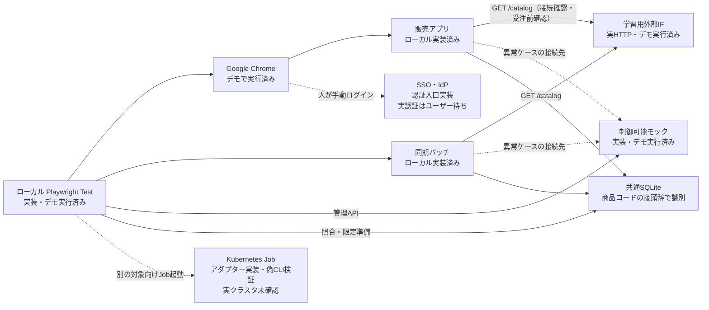

# 構成と確認状況

実線・破線とも接続の種類を示す。`upstream` と `mock` はケースごとに選ぶ代替の接続先で、同時に本番サービスを呼ぶものではない。学習用外部IFへの**実HTTP**は実装・ローカル実行済みだが、本番外部サービスの検証ではない。SQLiteによる結果はMySQL・AWS上の挙動の証明ではない。

- [販売アプリ・外部IF・モック](../../demo/sales/server.ts)：ローカルのHTTPサーバー。モックは業務GETと管理APIを分離する。
- [同期バッチ](../../demo/sales/batch.ts)と[DB処理](../../demo/sales/db.ts)：取得・検証後に共通SQLiteの今回所有する商品群へ反映する。試験は[ハーネス](../../tests/targets/sales/harness.ts)がプロセスを起動する。
- [Kubernetes Jobアダプター](../../test-support/kubernetes.ts)：Job起動・完了確認・停止確認の入口。偽CLIの局所試験はあるが、上図のローカル7ケースが実クラスタを起動するわけではなく、実クラスタ検証も未実施。
- [SSO入口](../../test-support/auth/setup.ts)：保存・新context・Chrome再起動後の確認を実装。実IdPへのログインと再利用はユーザーの手動操作待ち。通常のローカルデモ7ケースはSSOを要求しない。

全7ケースの実行対象と未確認は[ケース読解](seven-cases.md)、ローカル実行方法は[ハンズオン](hands-on.md)を参照する。
